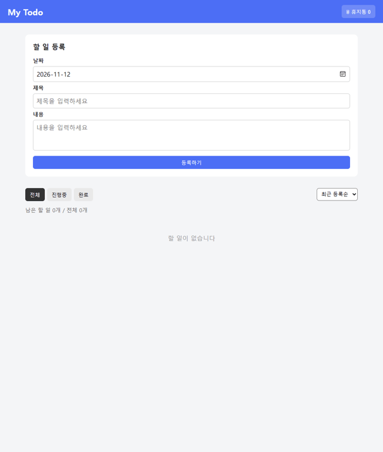

# Todo List (JavaScript 과제)

HTML, CSS, JavaScript로 만든 할 일 관리 페이지입니다.

## 파일 구조

```
index.html
css/style.css
js/todo.js
```

## 기능

- **추가**: 날짜, 제목, 내용을 입력해서 등록 (제목, 날짜가 비어 있으면 알림)
- **조회**: 전체 / 진행중 / 완료 필터, 최근 등록순 / 날짜순 정렬, 남은 할 일 개수 표시
- **수정**: 수정 버튼을 누르면 폼에 내용이 채워지고 수정 모드로 변경 (취소 가능)
- **삭제**: 삭제하면 휴지통으로 이동, 휴지통에서 복구 또는 영구 삭제
- **완료 체크**: 체크박스로 완료 표시
- 새로고침해도 데이터 유지 (localStorage)

## 사용한 것

- 배열 고차 함수: `filter`, `map`, `find`, `forEach`, `sort`
- DOM 조작: `createElement`, `textContent`, `append`, `classList`
- 이벤트: `submit`, `click`, `change`, 이벤트 위임 (`closest`로 카드 찾기)
- `<dialog>`로 휴지통 창 만들기
- CSS Grid로 카드 2칸 배치, 모바일(600px 이하)은 1칸

## 시연 영상

추가 → 날짜순 정렬 → 수정 → 완료 체크 / 필터 → 삭제 → 휴지통 복구 → 영구 삭제



원본 영상: [demo/demo.webm](demo/demo.webm)

## 실행 방법

`index.html`을 브라우저로 열면 됩니다.
